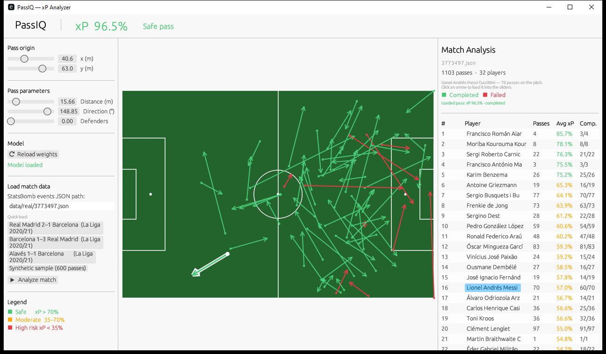

# ⚽ PassIQ: Expected Pass ($xP$) & Line-Breaking Analyzer

> A low-level football performance analytics engine built on real-time probabilistic inference, written in **Rust**, **`egui`** and **Python**.

<p align="center">
  
  
  
  
  
  
</p>

---

## 🚀 What is PassIQ?

PassIQ is a sports analytics tool that measures **Expected Pass ($xP$)** and assesses the real risk of passing lines in football, going beyond traditional statistics such as assists or pass completion percentage.

The system continuously quantifies (0% → 100%) the probability that a pass succeeds from **three geometric features of the match's physical domain**: Euclidean distance, angle to goal and defensive pressure along the trajectory. The result is a statistically calibrated probabilistic score, comparable to *Expected Goals* (xG) but applied to build-up play.

**Why it matters:** classic metrics treat every pass as binary (completed / failed) with no tactical context. A short backward pass under zero pressure and a vertical line-breaking pass look identical in conventional stats — PassIQ tells them apart quantitatively.

## 🖼️ Overview



Click a player in the ranking → the pitch fills with **every pass of that player in the match** (green = completed, red = failed).
Click an arrow → that pass is loaded into the sliders (origin, distance, direction and pressure) and the top bar shows its $xP$.

---

## 🛠️ Technical Architecture: The Hybrid Approach

PassIQ splits the machine-learning lifecycle into two independent, specialised phases:

```
┌──────────────────────────────────────────────────────────────────────┐
│  PHASE 1 — Python (offline, one-shot)                               │
│                                                                      │
│  StatsBomb JSON  ──►  Feature Extraction  ──►  Logistic Regression  │
│  (events/*.json)       (dist, angle, pres)      (sklearn, lbfgs)    │
│                                                   │                  │
│                                          model_weights.json          │
└──────────────────────────────────┬───────────────┘──────────────────┘
                                   │  (flat JSON, 10 floats)
┌──────────────────────────────────▼───────────────────────────────────┐
│  PHASE 2 — Rust + egui (online, 60 FPS)                             │
│                                                                      │
│  model_weights.json  ──►  PassModel::predict()  ──►  egui render    │
│                            (standardize → σ(z))    (pitch + arrow)  │
└──────────────────────────────────────────────────────────────────────┘
```

| Responsibility | Technology | Why |
|---|---|---|
| Historical data processing | Python + pandas / scikit-learn | Mature ML ecosystem, fast prototyping |
| Training and calibration | `LogisticRegression` (lbfgs, L2) | Calibrated, interpretable probabilities |
| Coefficient export | `serde_json` flat schema | Zero parsing overhead in Rust |
| Real-time inference | Native Rust | No GC, no heavy runtime, sub-ms latency |
| Graphical interface | `eframe` / `egui` 0.31 | GPU-accelerated, immediate mode, 60+ FPS |
| Match data | StatsBomb Open Data | De facto standard in football analytics |

---

## 📊 Mathematical Model

### Features extracted per pass

| Feature | Symbol | Description |
|---|---|---|
| Euclidean distance | $d$ | $\sqrt{(\Delta x)^2 + (\Delta y)^2}$ in metres |
| Angle to goal | $\theta$ | Angle between the pass vector and the $\text{origin} \to \text{goal}$ vector |
| Defensive pressure | $p$ | Defender density along the trajectory (0.0 – 1.0) |

### Inference formula

Each feature is standardised with the $(\mu, \sigma)$ learned during training (StandardScaler), so the model generalises correctly:

$$z = \beta_0 + \beta_{\text{dist}} \cdot \frac{d - \mu_d}{\sigma_d} + \beta_{\theta} \cdot \frac{\theta - \mu_\theta}{\sigma_\theta} + \beta_{p} \cdot \frac{p - \mu_p}{\sigma_p}$$

$$xP = \sigma(z) = \frac{1}{1 + e^{-z}}$$

### Trained coefficients (La Liga 2020/21)

```json
{
  "beta_distance":  -0.1495,
  "beta_angle":      1.1590,
  "beta_pressure":  -0.3481,
  "intercept":       0.4748,
  "training_mean":  [17.99, 66.93, 0.1396],
  "training_scale": [12.38, 42.61, 0.3466]
}
```

> **Interpretation:** `beta_distance` and `beta_pressure` are negative: longer passes and higher defensive pressure mean a lower completion probability. `beta_angle` is positive because the angle measures **deviation from the opponent's goal**: sideways or backward passes (more deviated) are safer than forward passes into the box. The model is calibrated on **3,424 real passes** from La Liga 2020/21 (2,921 completed / 503 failed).

### Risk classification

| $xP$ range | Label | Color |
|---|---|---|
| $xP > 70\%$ | ✅ Safe pass | 🟢 Green |
| $35\% \le xP \le 70\%$ | ⚡ Moderate risk | 🟠 Orange |
| $xP < 35\%$ | ❌ High risk — line-breaker | 🔴 Red |

---

## 📂 Repository Structure

```
passiq/
│
├── model_weights.json                                  ← coefficients exported by Python
├── passiq.exe                                          ← pre-built Windows x64 binary
├── LICENSE
├── .gitignore
├── requirements.txt                                    ← Python dependencies
│
├── generate_sample_data.py   ← builds a synthetic match in StatsBomb format
├── train_model.py            ← training and weight export
├── download_real_data.py     ← downloads real matches from StatsBomb Open Data
│
├── data/
│   ├── sample_match.json             ← synthetic match (600 passes, fixed seed)
│   └── real/
│       ├── 3773497.json              ← Real Madrid 2–1 Barcelona (La Liga 20/21)
│       ├── 3773585.json              ← Barcelona 1–3 Real Madrid (La Liga 20/21)
│       └── 3773386_*_Barcelona.json  ← Alavés 1–1 Barcelona      (La Liga 20/21)
│
├── docs/
│   └── player_passes.png             ← screenshot used in this README
│
└── passiq-rs/                        ← Rust application (cargo run from here)
    ├── Cargo.toml
    └── src/
        ├── main.rs    ← entry point: native 1280×720 window
        ├── paths.rs   ← path resolution independent of the working directory
        ├── model.rs   ← PassModel: JSON loading, standardisation, sigmoid
        ├── report.rs  ← batch analysis → per-player ranking by xP
        └── app.rs     ← PassIQApp: 3-panel UI, real-time inference
```

---

## ⚙️ Installation & Running

### Quick start (Windows, no build)

The repository ships a pre-built `passiq.exe` (x64). From the repository root:

```powershell
.\passiq.exe
```

1. Click **▶ Analyze match** (the *Real Madrid 2–1 Barcelona* Clásico is preloaded).
2. Click a player in the right panel → the pitch draws all of that player's passes.
3. Click an arrow → its values are loaded into the sliders and the top bar shows its $xP$.

To build it from scratch:

```bash
cd passiq-rs
cargo run --release
```

### Prerequisites

| Tool | Minimum version | Installation |
|---|---|---|
| Python | 3.10+ | [python.org](https://python.org) |
| Rust + Cargo | 1.78+ | `curl --proto '=https' --tlsv1.2 -sSf https://sh.rustup.rs \| sh` |
| scikit-learn | 1.3+ | `pip install -r requirements.txt` |

---

### Step 1 — Prepare the data

The repository already includes the three real La Liga 2020/21 matches in `data/real/`. To regenerate the synthetic match (or download more matches), use these scripts:

```bash
python generate_sample_data.py
# Output: data/sample_match.json  (660 events, 600 passes in StatsBomb format)
```

> **Real-data alternative:** download La Liga 2020/21 matches from StatsBomb Open Data on GitHub:
> ```bash
> python download_real_data.py
> # Output: data/real/3773497.json  (Real Madrid 2–1 Barcelona, 1,103 real passes)
> ```

---

### Step 2 — Train the model and export the weights

```bash
python train_model.py
# Output: model_weights.json
```

Expected output (with the three real matches included in `data/real/`):

```
=== PassIQ — Phase 1: xP Model Training ===

Using 3 real StatsBomb file(s): ['data/real/3773386_Deportivo_Alavés_vs_Barcelona.json', 'data/real/3773497.json', 'data/real/3773585.json']
  Loaded 'data/real/3773386_Deportivo_Alavés_vs_Barcelona.json': 3891 events.
  Loaded 'data/real/3773497.json': 3991 events.
  Loaded 'data/real/3773585.json': 4213 events.
Extraction: 3424 valid passes | 8671 non-pass events skipped | 0 passes dropped (missing fields).
Features: 3424 passes | 2921 completed | 503 failed.
Training: converged in 8 iterations.
Weights exported to 'model_weights.json':
{ ... }

=== Phase 1 complete ===
```

---

### Step 3 — Build and run the GUI

```bash
cd passiq-rs
cargo run            # development mode (debug)
cargo run --release  # production mode (maximum speed)
```

> **First build:** egui pulls ~400 dependency crates. It can take 2–5 minutes depending on your connection. Subsequent builds are incremental and take < 10 seconds.

You can also open `passiq-rs\target\release\passiq.exe` directly (double-click or shortcut):
the relative paths of `model_weights.json` and `data/` are resolved against the project root,
not against the directory the executable was launched from.

---

## 🖥️ User Interface

PassIQ uses a **3-column layout** designed for simultaneous analysis:

```
┌──────────────────────────────────────────────────────────────────────────────┐
│  PassIQ                xP  83.2%    Safe pass                               │
├──────────────┬─────────────────────────────────────┬────────────────────────┤
│ Pass origin  │                                     │ Match Analysis         │
│  x  ──●──   │                                     │                        │
│  y  ──●──   │         [ PITCH 120×80 m ]          │ #  Player  Passes  xP  │
│             │                                     │ 1  Pedri     45   82%  │
│ Parameters  │         🟢 ──────────────►          │ 2  Busquets  52   78%  │
│  Dist  ●──  │                                     │ 3  Alba      38   75%  │
│  Dir   ──●  │                                     │ ...                    │
│  Def   ●──  │                                     │                        │
│             │                                     │                        │
│ ⟳ Reload   │                                     │                        │
│ ▶ Analyze  │                                     │                        │
└──────────────┴─────────────────────────────────────┴────────────────────────┘
```

### Left panel — interactive controls
- **Pass origin:** pass origin coordinates on the pitch (x: 0–120 m, y: 0–80 m)
- **Distance:** pass length in metres (0–120 m)
- **Direction:** absolute pass direction in degrees (-180° → 180°)
- **Defenders:** defender density along the trajectory (0–5), mapped to pressure 0.0–1.0
- **⟳ Reload weights:** reloads `model_weights.json` on the fly without restarting
- **Quick load:** one-click buttons for the pre-downloaded real matches
- **▶ Analyze match:** loads the given JSON file and runs the full analysis

### Central panel — interactive pitch
- Football pitch drawn to StatsBomb scale (120×80 m) with all regulation lines
- Pass arrow that updates position, direction and **color in real time** from the computed $xP$
- Highlighted pass origin
- With a player selected, the pitch fills with **every pass of that player in the match**:
  - green = completed pass, red = failed pass
  - clicking any arrow → the pass is highlighted in white and **its values are loaded into the sliders**
    (origin, distance, direction and pressure), so the top bar shows its exact $xP$
  - moving a slider releases the highlight and the pitch models the sliders again

### Right panel — player ranking
- Table of every player in the loaded match
- Columns: `#` | `Player` | `Passes` | `Avg xP` | `Comp./Total`
- Sorted by `avg_xP` descending (best passer according to the model)
- The `Avg xP` value uses the same color code (🟢/🟠/🔴) as the pitch
- **Click a player** → draws all of their passes on the pitch (click again to clear the selection)

---

## 🔬 Code Design: LOTA-F Style

All PassIQ code — both Python and Rust — follows the **LOTA-F** style (*Linear One-directional Transparent Architecture - Forward*):

> *"Data and control always move forward. Never backwards, never sideways, never to an unknown destination."*

**Applied principles:**
- **Explicit one-directional flow:** `INPUT → stage_1 → stage_2 → OUTPUT`
- **Pure functions:** every function receives its input as a parameter and returns its output by value. No globals, no hidden effects.
- **Explicit types:** every signature, variable and field is annotated.
- **Driver as the book's index:** `main()` in Python and `update()` in Rust only orchestrate — they do not compute business logic.
- **Errors as values:** `Result<T, E>` in Rust, `sys.exit(1)` with a message in Python. No silent exceptions.
- **No hidden behaviour:** no callbacks, no dynamic dispatch in the core, no mutable global state.

```
# Python — LOTA-F pipeline
raw_events  = load_events_json(input_path)      # stage 1
passes      = extract_valid_passes(raw_events)  # stage 2
X, y        = build_feature_matrix(passes)      # stage 3
model, sc   = train_logistic_model(X, y)        # stage 4
weights     = extract_weights(model, sc)        # stage 5
             export_weights_json(weights, out)  # stage 6
```

```rust
// Rust — update() as a pure driver
let result = compute_inference(&self.model_state, &self.sliders);      // 1
show_top_panel(ctx, &result);                                         // 2
show_left_panel(ctx, &mut self.sliders, ...);                         // 3
show_right_panel(ctx, &self.match_load_state, &mut self.selection);   // 4
show_central_panel(ctx, &mut self.sliders, &result, ...);             // 5
```

---

## 📈 Data: StatsBomb Open Data

PassIQ consumes the official [StatsBomb Open Data](https://github.com/statsbomb/open-data) format directly:

- **Format:** one JSON file per match → `events/{match_id}.json`
- **Pass event structure used:**

```json
{
  "id":       "uuid",
  "type":     { "name": "Pass" },
  "location": [61.0, 40.1],
  "player":   { "name": "Lionel Andrés Messi Cuccittini" },
  "pass": {
    "end_location": [75.3, 38.2],
    "outcome": { "name": "Incomplete" }
  },
  "under_pressure": true
}
```

> **StatsBomb convention:** if the `pass.outcome` field is **absent**, the pass was completed. If it is **present**, the pass failed. PassIQ implements this convention in `report.rs` and `train_model.py`.

---

## 🏆 Pre-downloaded Matches

| Match ID | Match | Passes | Sample player |
|---|---|---|---|
| `3773497` | Real Madrid **2–1** Barcelona | 1,103 | Lionel Messi |
| `3773585` | Barcelona **1–3** Real Madrid | 1,203 | Karim Benzema |
| `3773386` | Alavés **1–1** Barcelona | 1,118 | Antoine Griezmann |

To download additional matches (other competitions or seasons):
```python
# download_real_data.py — configuration lines
TARGET_COMPETITION_ID: int = 11   # 11=La Liga, 16=Champions League
TARGET_SEASON_ID:      int = 90   # 90=2020/21
match_index:           int = 5    # index of the match in the season list
```

---

## 🔧 Technical Dependencies

### Python
```
scikit-learn  >= 1.3
numpy         >= 2.0
(stdlib: json, math, random, uuid, urllib.request)
```

### Rust (`Cargo.toml`)
```toml
eframe     = "0.31"   # native window + render loop
egui       = "0.31"   # immediate mode GUI + 2D painter
serde      = { version = "1", features = ["derive"] }
serde_json = "1"      # model_weights.json deserialisation
```

---

## 🚀 Production Build

```bash
cd passiq-rs
cargo build --release
# Optimised binary: passiq-rs/target/release/passiq.exe  (Windows)
#                   passiq-rs/target/release/passiq       (Linux/macOS)
```

Release flags configured in `Cargo.toml`:
```toml
[profile.release]
opt-level     = 3
lto           = true    # Link-Time Optimization → smaller and faster binary
codegen-units = 1       # maximum cross-unit optimisation
strip         = true    # removes debug symbols from the final binary
```

---

## 📋 Reproducibility Checklist

```
[ ] python generate_sample_data.py          → data/sample_match.json
[ ] python train_model.py                   → model_weights.json
[ ] python download_real_data.py            → data/real/*.json
[ ] cd passiq-rs && cargo build             → 0 errors, 0 warnings
[ ] cargo run                               → PassIQ window opens
[ ] Quick load → "Real Madrid 2–1 Barcelona"
[ ] Click ▶ Analyze match                   → player ranking in the right panel
[ ] Click a player                          → every pass of that player on the pitch
[ ] Click an arrow                          → sliders jump to that pass, top bar shows its xP
[ ] Move the "Distance" slider 5 m → 40 m   → arrow turns from 🟢 to 🔴
```

---

## 📄 License

This project is licensed under the [MIT License](LICENSE).

StatsBomb Open Data is subject to the [StatsBomb Open Data License](https://github.com/statsbomb/open-data/blob/master/LICENSE.pdf) — free for non-commercial and research use with attribution.

---

## 🙌 Credits

- **StatsBomb** — for the open match event data.
- **egui / eframe** (Emil Ernerfeldt and contributors) — for the immediate-mode UI framework in Rust.
- **scikit-learn** (INRIA and contributors) — for the calibrated logistic regression implementation.

---

<p align="center">
  <sub>Built for a sports analytics hackathon · PassIQ © 2026</sub>
</p>
